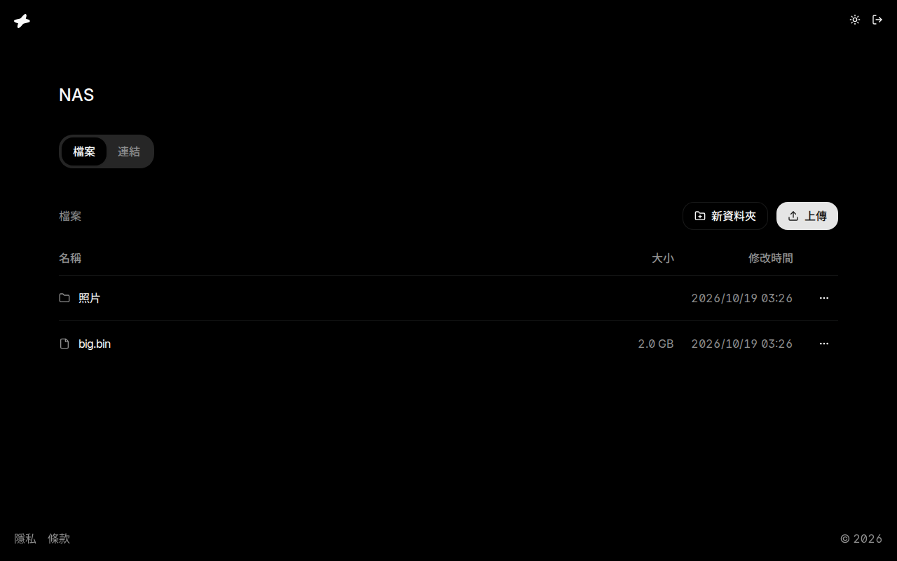
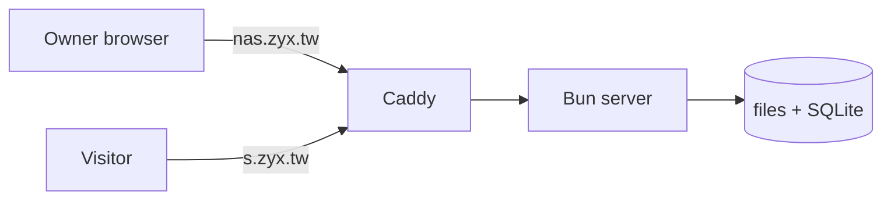

<div align="center">

<h1>nas</h1>

<p><strong>A personal web drive with passkey login and public share links.</strong></p>

**English** | [繁體中文](README.zh-TW.md) | [简体中文](README.zh-CN.md)

</div>



You keep your files on your own server and open them from any browser. You send a short link, and anyone with the link can download the file.

## Features

- **Sign in with a passkey**: at auth.zyx.tw, shared by my services. Touch ID or Face ID, no password.
- **Manage files**: upload, make folders, rename, delete and download.
- **Share a link**: `s.zyx.tw/<id>` opens the file itself in the browser, or a plain folder list.
- **Revoke a link**: a revoked or expired link gives the same 404 as an unknown one.
- **Stream big files**: uploads go straight to disk, and downloads support ranges.

## Quick start

```sh
bun install
bun run build
bun run start
```

Sign-in goes through auth.zyx.tw, so a local run needs `NAS_AUTH_ORIGIN` pointed at an auth server.

## Usage

1. Click **上傳**, or drop files on the list.
2. Open the row menu and click **分享**.
3. Select an expiry and click **建立連結**. The link goes to the clipboard.
4. Open the **連結** tab to see every link and revoke one.

## Configuration

| Key | Sets | Default |
|-----|------|---------|
| `NAS_ORIGIN` | the owner app origin, also the token audience | `http://localhost:8080` |
| `NAS_SHARE_ORIGIN` | the public share origin, on a different host | `http://127.0.0.1:8080` |
| `NAS_AUTH_ORIGIN` | where sign-in happens | `https://auth.zyx.tw` |
| `NAS_DATA` | the folder for files, uploads in progress and the database | `./data` |
| `NAS_DIST` | the built web app | `./dist` |
| `NAS_PORT` | the listen port | `8080` |
| `OTEL_EXPORTER_OTLP_ENDPOINT` | where OTLP/HTTP JSON logs go | off |

## How it works



One Bun process serves both hosts and routes by the `Host` header. The session cookie belongs only to the owner host, so a shared file can never read it. SQLite holds the session hashes and the links. Passkeys live at auth.zyx.tw.

## For AI agents

Facts for coding agents and LLM tools. The rules for changing the code are in [AGENTS.md](AGENTS.md).

- **Summary**: A single-owner web drive with sign-in through auth.zyx.tw and public share links on a second host.
- **Type**: service
- **Interfaces**: HTTP `https://nas.zyx.tw/api` (owner, session cookie), HTTP `https://s.zyx.tw/<id>` (public)
- **Install**: `bun install`
- **Run**: `bun run start`
- **Verify**: `bun test server`
- **Config**: `NAS_ORIGIN`, `NAS_SHARE_ORIGIN`, `NAS_AUTH_ORIGIN`, `NAS_DATA`, `NAS_DIST`, `NAS_PORT`, `OTEL_EXPORTER_OTLP_ENDPOINT`, `OTEL_EXPORTER_OTLP_HEADERS`, `OTEL_SERVICE_NAME`
- **Secrets**: the OTLP header lives in `/etc/nas/env` on the server.
- **Limits**: One owner only. A move or rename made outside the app does not update links.

## Development

```sh
git clone https://github.com/zyx-tw/nas && cd nas
bun install
bun test server && bun run typecheck && bun run lint
```

A merge to `main` deploys itself: the pull request builds the bundle (`deploy/release.Dockerfile`), and land ships it to the nas CT, where carrel-deployd runs `deploy/carrel-start.sh`.

## License

[MIT](LICENSE)
