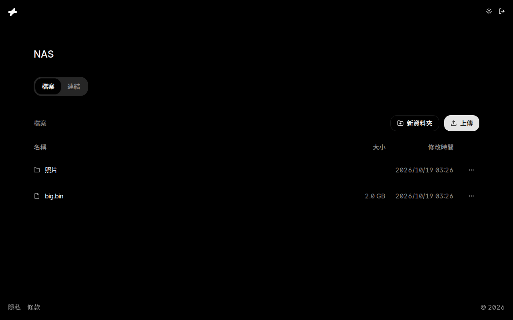
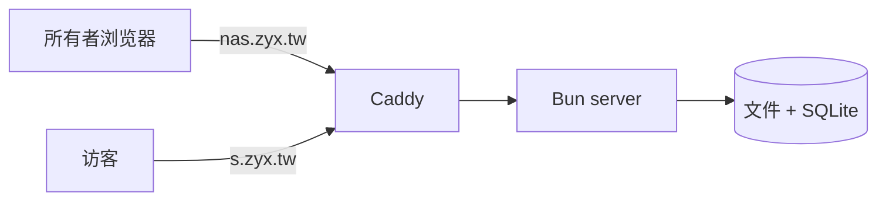

<!-- 翻译自 README.md @ 2670634 -->

<div align="center">

<h1>nas</h1>

<p><strong>用 passkey 登录的个人网盘，附公开分享链接。</strong></p>

[English](README.md) | [繁體中文](README.zh-TW.md) | **简体中文**

</div>



文件放在自己的服务器上，任何浏览器都能打开。发出一个短链接，拿到链接的人就能下载。

## 功能

- **用 passkey 登录**：在 auth.zyx.tw 登录，我的服务共用这个入口。Touch ID 或 Face ID，不用密码。
- **管理文件**：上传、建文件夹、重命名、删除、下载。
- **分享链接**：`s.zyx.tw/<id>` 在浏览器直接打开文件本身，文件夹则是一份纯列表。
- **撤销链接**：撤销或过期的链接，和不存在的链接返回一样的 404。
- **大文件流式传输**：上传直接写入磁盘，下载支持分段。

## 快速开始

```sh
bun install
bun run build
bun run start
```

登录走 auth.zyx.tw，本机运行时要把 `NAS_AUTH_ORIGIN` 指向一台 auth 服务。

## 使用

1. 点 **上傳**，或把文件拖到列表上。
2. 打开该行的菜单，点 **分享**。
3. 选期限，点 **建立連結**。链接会复制到剪贴板。
4. 打开 **連結** 标签页，查看全部链接并撤销。

## 配置

| 变量 | 设置什么 | 默认 |
|-----|------|---------|
| `NAS_ORIGIN` | 所有者页面的 origin，也是 token 的 audience | `http://localhost:8080` |
| `NAS_SHARE_ORIGIN` | 公开分享的 origin，必须是另一个主机名 | `http://127.0.0.1:8080` |
| `NAS_AUTH_ORIGIN` | 登录入口 | `https://auth.zyx.tw` |
| `NAS_DATA` | 文件、上传暂存与数据库的文件夹 | `./data` |
| `NAS_DIST` | 构建好的网页 | `./dist` |
| `NAS_PORT` | 监听端口 | `8080` |
| `OTEL_EXPORTER_OTLP_ENDPOINT` | OTLP/HTTP JSON 日志的去处 | 关 |

## 工作原理



同一个 Bun 进程服务两个主机名，按 `Host` header 分流。登录 cookie 只属于所有者的主机名，所以分享出去的文件读不到它。SQLite 存 session 哈希与链接，passkey 在 auth.zyx.tw。
