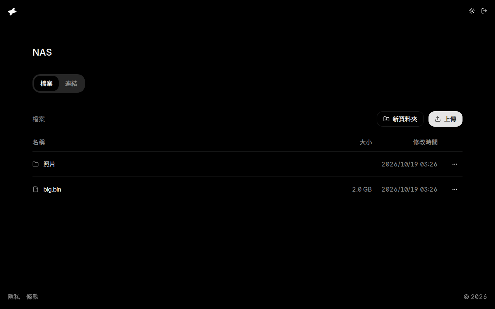
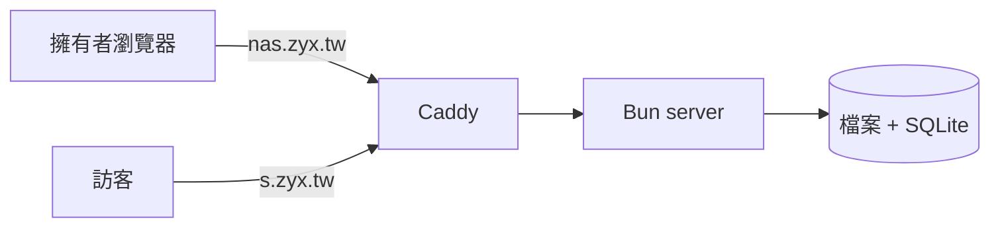

<!-- 翻譯自 README.md @ 2670634 -->

<div align="center">

<h1>nas</h1>

<p><strong>用 passkey 登入的個人雲端硬碟，附公開分享連結。</strong></p>

[English](README.md) | **繁體中文** | [简体中文](README.zh-CN.md)

</div>



檔案放在自己的伺服器上，任何瀏覽器都能開。傳一個短連結出去，拿到連結的人就能下載。

## 功能

- **用 passkey 登入**：Touch ID 或 Face ID，不用密碼。
- **管理檔案**：上傳、建資料夾、重新命名、刪除、下載。
- **分享連結**：`s.zyx.tw/<id>` 在瀏覽器直接打開檔案本身，資料夾則是一份純清單。
- **撤銷連結**：撤銷或過期的連結，和不存在的連結回一樣的 404。
- **大檔串流**：上傳直接寫進磁碟，下載支援分段。

## 快速開始

```sh
bun install
bun run build
NAS_SETUP_TOKEN=change-me bun run start
```

打開 `http://localhost:8080/?setup=change-me`，註冊一個 passkey。

## 使用

1. 按 **上傳**，或把檔案拖到列表上。
2. 打開該列的選單，按 **分享**。
3. 選期限，按 **建立連結**。連結會複製到剪貼簿。
4. 打開 **連結** 分頁，看全部連結並撤銷。

## 設定

| 變數 | 設定什麼 | 預設 |
|-----|------|---------|
| `NAS_ORIGIN` | 擁有者頁面的 origin，也是 passkey 的 RP ID | `http://localhost:8080` |
| `NAS_SHARE_ORIGIN` | 公開分享的 origin，必須是另一個主機名稱 | `http://127.0.0.1:8080` |
| `NAS_SETUP_TOKEN` | 註冊第一個 passkey 用的 token | 空 |
| `NAS_DATA` | 檔案、上傳暫存與資料庫的資料夾 | `./data` |
| `NAS_DIST` | 建好的網頁 | `./dist` |
| `NAS_PORT` | 監聽 port | `8080` |
| `OTEL_EXPORTER_OTLP_ENDPOINT` | OTLP/HTTP JSON log 的去處 | 關 |

## 運作方式



同一個 Bun 程序服務兩個主機名稱，依 `Host` header 分流。登入 cookie 只屬於擁有者的主機名稱，所以分享出去的檔案讀不到它。SQLite 存 passkey、session 雜湊與連結。
